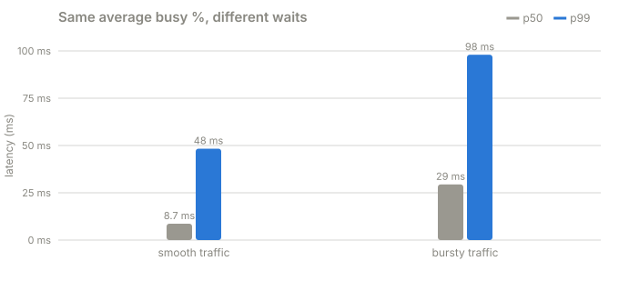
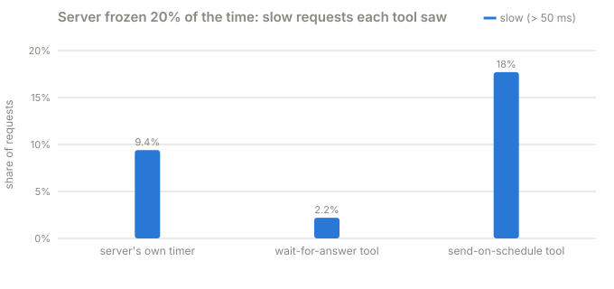

# Challenge 1 · Latency under load

**Why does a server get slow, and how do you measure it without fooling yourself?**

Four parts, each building on the one before. Every part runs on your laptop in about a
minute against a real server, prints its results, and links every number back to the
line of code that made it.

| Part | The question | The answer, in one line |
|---|---|---|
| [1 · The knee](part-1-the-knee) | How busy can a server get before people notice? | About 75%. After that, waiting shoots up. |
| [2 · Averages lie](part-2-averages-lie) | Can the graphs say "fine" while people wait? | Yes. Bursts hide in averages, and some tools miss most slow requests. |
| [3 · Tail at scale](part-3-tail-at-scale) | What if one page needs 50 servers to answer? | A rare slow server makes 40% of pages slow. Asking again when late fixes it. |
| [4 · Adaptive hedging](part-4-adaptive-hedging) | How late is "late" when normal calls get slower? | Set the timer from recent calls, not a fixed number, and cap the extra calls. |

## 101: the words you need

You don't need any background. These are the only ideas the four parts use.

- **Server**: a program that waits for requests and answers them. A website, an API, a
  database. Ours is a small fake server that runs on your laptop
  ([code](../../toolkit/jiffy-service/src/jiffy_service/server.py#L65)).
- **Request**: one question sent to the server ("give me this page"). Ours just says "do
  10 ms of work".
- **Worker**: the part of the server that does the work. Our server has 4, so it can work
  on 4 requests at the same time.
- **Queue**: the line requests wait in when every worker is busy, like a supermarket
  checkout.
- **Latency**: how long someone waited for their answer, from the moment they asked to
  the moment the answer arrived. Waiting in the queue plus the work itself. This is the
  number people feel.
- **p50, p99**: sort everyone's latency from fastest to slowest. p50 is the person in the
  middle (the typical wait). p99 is the person 99% of the way down: only 1 in 100 waited
  longer. The unhappy people live in the p99.
- **Busy % (utilization)**: how much of the time the workers were working. 50% means
  they were idle half the time.
- **Throughput**: how many requests the server finished per second.
- **Load generator**: a program that pretends to be lots of users sending requests
  ([code](../../toolkit/jiffy-load/src/jiffy_load/runner.py#L69)).

A request's life, and where each of those times comes from:

```
 you want an answer          the server reads it        a worker picks it up        answer arrives
        |                           |                           |                           |
        |------- network -----------|-------- queue ------------|-------- work -------------|
        |                           |<-------- wait ----------->|<------- service --------->|
        |<---------------------------------- latency ------------------------------------->|
```

## Part 1 · The knee

Add traffic step by step, from 10% busy to 95%. Waiting barely moves until about 75–80%,
then shoots up: p99 went from 58 ms to 250 ms.


[Read part 1 →](part-1-the-knee)

## Part 2 · Averages lie

Smooth and bursty traffic, both "48% busy" on a one-second graph. Bursts made the
typical wait 3x longer.



Then the server freezes 20% of the time, and three tools measure it. Only the one that
sends on a schedule sees the truth.



[Read part 2 →](part-2-averages-lie)

## Part 3 · Tail at scale

Each backend is slow 1 time in 100. A page that needs 50 of them is slow 40% of the time.


Asking again when a call is late (hedging) takes most of that back:


[Read part 3 →](part-3-tail-at-scale)

## Part 4 · Adaptive hedging

Normal calls drift from 2 ms to 14 ms. A fixed 10 ms "late" timer ends up resending most
calls. A timer that follows recent latency rescues the same stuck calls for a fraction of
the extra work.


[Read part 4 →](part-4-adaptive-hedging)

## Run it

From the repository folder:

```bash
uv sync
uv run challenges/challenge-1-latency-under-load/part-1-the-knee/knee.py
uv run challenges/challenge-1-latency-under-load/part-2-averages-lie/averages_lie.py
uv run challenges/challenge-1-latency-under-load/part-3-tail-at-scale/tail_at_scale.py
uv run challenges/challenge-1-latency-under-load/part-4-adaptive-hedging/adaptive_hedging.py
```

Add `--quick` to any of them for a shorter run. Each saves its tables to `results.md` in
its folder. To redraw the charts afterwards, run `uv run tools/charts.py`.

Or watch them live in the browser: `uv run jiffy-ui`, pick a part, and press Run.

## How every part works

1. **Start the server** in its own process, so it behaves like a separate machine.
2. **Measure first.** Check how long "10 ms of work" really takes on this laptop (it's
   never exactly 10).
3. **Send load** on a fixed schedule, like real users who don't wait for each other.
4. **Collect two views** of the same run and print them side by side: the users' view
   (latency for every request) and the server's view (how busy it was, how long its
   queue got). The lessons are usually in the gap between the two.

## Folder layout

```
challenge-1-latency-under-load/
  README.md                  you are here
  part-1-the-knee/
    README.md                the idea from zero, step by step, every number linked to code
    knee.py                  the whole experiment, top to bottom
    results.md               the latest measured numbers
    chart.svg                drawn from results.md
    test_knee.py             checks the part does what its README says
  part-2-averages-lie/       same shape
  part-3-tail-at-scale/      same shape
  part-4-adaptive-hedging/   same shape
```
