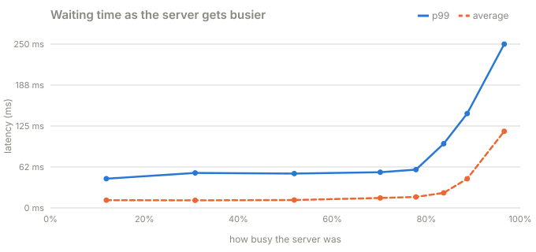

# Part 1 · The knee

**Question:** how busy can a server get before people notice it's slow?

**Answer:** about 75–80% busy. Up to there, waiting time barely moves. After it, a little
more traffic means a lot more waiting. Draw latency against busy % and the line bends
sharply upward, like a knee.

## Run it

From the repository folder:

```bash
uv run challenges/challenge-1-latency-under-load/part-1-the-knee/knee.py            # about a minute
uv run challenges/challenge-1-latency-under-load/part-1-the-knee/knee.py --quick    # about fifteen seconds
```

It prints three tables and saves them to [results.md](results.md).

## The idea, from zero

Think of a coffee shop with **4 baristas** (our server's 4 workers). Each coffee takes
about **10 ms** to make (our "work"). Customers walk in at random times.

- When few customers come in, a barista is almost always free. You walk in, you get your
  coffee in about 10 ms. Nobody waits in line.
- When customers arrive almost as fast as the baristas can serve, every barista is busy
  most of the time. Now when you walk in, there's usually a line. Customers arrive at
  random, so sometimes five come in at once, and the line grows faster than it shrinks.
- The busier the shop, the more often you hit a line, and the longer the line is when you
  do. That's why the waiting doesn't grow evenly. It's flat for a long time, then shoots up.

This part measures that on a real server, so you can see the bend for yourself.

## What the part does, step by step

| Step | What happens | Code |
|---|---|---|
| 1 | Start the fake server with 4 workers, in its own process | [`spawn(WORKERS)`](knee.py#L155), [`WORKERS = 4`](knee.py#L28) |
| 2 | **Measure first:** send gentle traffic and check how long "10 ms of work" really takes here. It comes out at about 10.4 ms, because the laptop never sleeps exactly 10 ms | [`calibrate`](knee.py#L156) → [`calibrate()`](../../../toolkit/jiffy-service/src/jiffy_service/experiment.py#L79) |
| 3 | For each target (10%, 30%, … 95% busy), work out how many requests per second hit that target: `rate = busy × workers ÷ work time` | [`rate = …`](knee.py#L64), [targets](knee.py#L30) |
| 4 | Make a random schedule of when each request will be sent, like customers walking in at random | [`poisson(...)`](knee.py#L65) → [`poisson()`](../../../toolkit/jiffy-load/src/jiffy_load/arrivals.py#L13) |
| 5 | Send every request **at its scheduled time**, even if earlier ones haven't been answered yet, and time each one | [`drive_open`](knee.py#L67) → [`open_loop()`](../../../toolkit/jiffy-load/src/jiffy_load/runner.py#L69) |
| 6 | Inside the server: a request arrives, waits in the queue, a worker picks it up, does the work, replies | [arrives](../../../toolkit/jiffy-service/src/jiffy_service/server.py#L132), [picked up](../../../toolkit/jiffy-service/src/jiffy_service/server.py#L155), [work](../../../toolkit/jiffy-service/src/jiffy_service/server.py#L158), [reply](../../../toolkit/jiffy-service/src/jiffy_service/server.py#L162) |
| 7 | Compare with two predictions: the queueing **formula**, and a **perfect simulation** of the same customers | [`MMc(...)`](knee.py#L74), [`fcfs(...)`](knee.py#L73) |
| 8 | Bigger targets run longer, because near the top the line swings wildly and short runs are mostly luck | [`duration_for`](knee.py#L34) |

## The results

From the last full run on this laptop ([results.md](results.md)):



| aimed | busy (server) | req/s | max queue | mean: theory | sim | real | p99: sim | real |
|---|---|---|---|---|---|---|---|---|
| 10% | 11.9% | 43 | 1 | 11.2 ms | 11.2 ms | 11.8 ms | 44.2 ms | 44.6 ms |
| 30% | 30.8% | 114 | 3 | 11.1 ms | 11.0 ms | 11.5 ms | 52.9 ms | 53.4 ms |
| 50% | 51.9% | 200 | 7 | 11.7 ms | 11.5 ms | 12.0 ms | 51.8 ms | 52.4 ms |
| 70% | 70.2% | 271 | 11 | 14.6 ms | 14.3 ms | 15.2 ms | 53.4 ms | 54.5 ms |
| 80% | 77.8% | 307 | 16 | 16.9 ms | 15.6 ms | 16.7 ms | 57.3 ms | 58.4 ms |
| 85% | 83.7% | 330 | 32 | 21.4 ms | 20.5 ms | 23.0 ms | 91.4 ms | 98.0 ms |
| 90% | 88.7% | 342 | 50 | 29.9 ms | 36.9 ms | 44.5 ms | 128 ms | 144 ms |
| 95% | 96.6% | 367 | 98 | 120 ms | 90.9 ms | 117 ms | 219 ms | 250 ms |

### Where each number comes from

| Column | In plain words | Measured by | Code |
|---|---|---|---|
| aimed | the busy % we were trying to reach | the part | [targets](knee.py#L30) |
| busy (server) | how much of the time the 4 workers were actually working | the **server**, counting every start and finish | [`utilization`](knee.py#L52) → [`summary()`](../../../toolkit/jiffy-metrics/src/jiffy_metrics/use.py#L161) |
| req/s | requests finished per second (throughput) | the client | [`throughput()`](../../../toolkit/jiffy-load/src/jiffy_load/runner.py#L150) |
| max queue | the longest the line ever got | the server | [`max_queue`](knee.py#L57) → [`use.py`](../../../toolkit/jiffy-metrics/src/jiffy_metrics/use.py#L148) |
| mean: theory | average wait predicted by the queueing formula (M/M/c) | math, no measuring | [`mean_latency`](../../../toolkit/jiffy-queueing/src/jiffy_queueing/theory.py#L77) |
| sim | average wait if the same customers had gone through a perfect queue | a simulation of this exact run | [`fcfs()`](../../../toolkit/jiffy-queueing/src/jiffy_queueing/simulate.py#L36) |
| real | average wait people actually got | the **client**, from when each request was due to when its answer came back | [`latency`](../../../toolkit/jiffy-load/src/jiffy_load/runner.py#L46) |
| p99: sim / real | the wait of the 1-in-100 unluckiest request | same as above, then sorted | [`percentile()`](../../../toolkit/jiffy-metrics/src/jiffy_metrics/histogram.py#L85) |

## What it means

- **Flat, then up.** From 12% to 78% busy, p99 only moved from 45 to 58 ms. From 78% to 97%
  it went from 58 to 250 ms: more than 4x worse, for about 20% more traffic.
- **Even with no line at all, p99 is about 4x the average.** At 10% busy nobody waits, yet
  p99 is 45 ms against an 11.8 ms average. Our work times are random, so a few requests
  are simply long. Queueing comes on top of that.
- **Real ≈ simulation.** The real server is within about 1 ms of a perfect queue until
  ~80% busy. The small extra is the server's own overhead (reading the network, Python
  itself). Near the top, that overhead gets multiplied by the line.
- **Theory is an average over forever; one run is not.** At 90% and 95%, the formula and
  the simulation disagree by 20–30%. Near the knee, a 12-second run can be calmer or
  busier than the long-run average. One short load test near capacity tells you little.
- **The practical rule:** keep busy servers under about 70–75%. That headroom is what
  keeps waiting short.

The first table the part prints is the formula on its own. It shows the same thing with no
noise: one worker at 90% busy makes people wait 10x the work time, while 4 workers
sharing one line at 90% make them wait about 3x. Sharing one line between several
workers pushes the knee to the right.

## Try this

- Change [`WORKERS`](knee.py#L28) to 1 or 16 and watch the knee move.
- Make every request exactly 10 ms. Change [`work = …`](knee.py#L66) to
  `work = [MEAN_WORK] * len(schedule)`. Less randomness means shorter lines at the same
  busy %.
- Run with `--duration 15` to get steadier numbers near the top.

## Files

| File | What's in it |
|---|---|
| [knee.py](knee.py) | the whole part |
| [results.md](results.md) | the last full run |
| [test_knee.py](test_knee.py) | checks the part: theory, simulation and reality line up |
