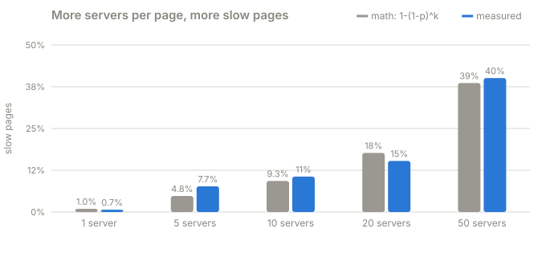
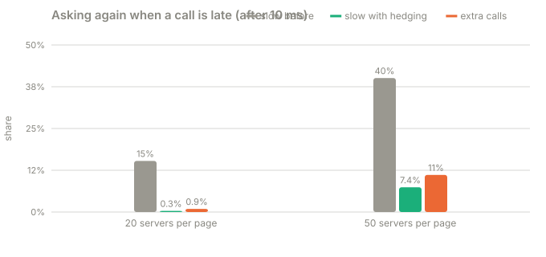

# Part 3 · Tail at scale

**Question:** what happens when one page needs answers from many servers at once?

**Answer:** a server that's slow only 1 time in 100 makes **40%** of pages slow once each
page asks 50 of them. A cheap fix: if an answer is late, ask again and take whichever
answer comes first ("hedging"). At 20 servers per page it takes slow pages from 15% to
0.3% for under 1% extra calls, as long as the "late" timer is set sensibly (see
[the catch](#the-catch)).

Read [Part 1](../part-1-the-knee) first if words like *latency* or *p99* are new.

## Run it

```bash
uv run challenges/challenge-1-latency-under-load/part-3-tail-at-scale/tail_at_scale.py            # about a minute and a half
uv run challenges/challenge-1-latency-under-load/part-3-tail-at-scale/tail_at_scale.py --quick    # about 30 seconds
```

## The idea, from zero

You open a social media feed. Behind the scenes, that one page asks **many** servers for
pieces: your posts, your friends' posts, ads, notifications, comments. The page can only
show when **all** of them have answered. One straggler holds up the whole page.

Say each server is fast 99 times out of 100 and slow 1 time out of 100.

- A page that asks **1** server is slow 1% of the time.
- A page that asks **50** servers is slow whenever *any* of the 50 is slow. The chance that
  all 50 are fast is 0.99 × 0.99 × … (50 times) = 0.99⁵⁰ ≈ 0.61. So the page is slow
  about **39%** of the time, even though no single server got any worse.

The rare slow case (the **tail** of the latency curve) becomes the common case at scale.
That's the "tail at scale".

**Hedging:** if a call hasn't answered by the time it normally would have, send the same
call again. Whichever copy answers first wins. Most of the time the second copy lands on
a fast moment and comes back quickly.

## What the part does

| Step | What happens | Code |
|---|---|---|
| 1 | Start a server with 64 workers, so nothing ever waits in line. This part is about randomness, not busyness | [`WORKERS = 64`](tail_at_scale.py#L33), [`spawn`](tail_at_scale.py#L148) |
| 2 | Each backend call takes **2 ms** 99% of the time and **50 ms** 1% of the time | [`FAST, SLOW, SLOW_SHARE`](tail_at_scale.py#L34), [`backend_work`](tail_at_scale.py#L60) |
| 3 | A "page" sends `k` calls at once and waits for all of them | [`fan_out`](tail_at_scale.py#L64), [calls sent](tail_at_scale.py#L85), [wait for all](tail_at_scale.py#L95) |
| 4 | Pages arrive at 25 per second, on a schedule | [`FRONT_RATE`](tail_at_scale.py#L37), [`measure`](tail_at_scale.py#L119) |
| 5 | Try `k` = 1, 5, 10, 20, 50 | [`FANOUTS`](tail_at_scale.py#L38), [loop](tail_at_scale.py#L152) |
| 6 | Hedge: at 10 ms, resend every call that hasn't answered yet, keep the first answer | [`HEDGE_AFTER`](tail_at_scale.py#L36), [timer](tail_at_scale.py#L90), [resend](tail_at_scale.py#L92), [first wins](tail_at_scale.py#L70) |
| 7 | A page or call counts as **slow** if it takes over 20 ms | [`THRESHOLD`](tail_at_scale.py#L35) |

## The results

From the latest full run on this laptop ([results.md](results.md)):



**A · Fan-out.** Each backend call was slow `p` = 0.97% of the time:

| pages ask `k` servers | slow: theory | slow: measured | p50 | p90 | p99 |
|---|---|---|---|---|---|
| 1 | 0.97% | 0.69% | 3.07 ms | 3.39 ms | 4.14 ms |
| 5 | 4.8% | 7.7% | 3.43 ms | 4.18 ms | 51.8 ms |
| 10 | 9.3% | 10.6% | 4.44 ms | 51.3 ms | 52.9 ms |
| 20 | 17.7% | 15.3% | 4.44 ms | 51.3 ms | 52.4 ms |
| 50 | 38.6% | 40.1% | 7.98 ms | 52.9 ms | 57.3 ms |



**B · Hedging** after 10 ms:

| `k` | slow before | slow with hedging | p99 before | p99 with hedging | extra calls |
|---|---|---|---|---|---|
| 20 | 15.3% | 0.33% | 52.4 ms | 15.2 ms | 0.94% |
| 50 | 40.1% | 7.4% | 57.3 ms | 40.0 ms | 11.1% |

### Where each number comes from

| Column | In plain words | Code |
|---|---|---|
| p (heading) | how often one backend call was really slow, measured over every call | [`p = …`](tail_at_scale.py#L160), [per call](tail_at_scale.py#L96) |
| slow: theory | the math: chance at least one of `k` calls is slow, `1 − (1 − p)^k` | [`1 - (1 - p) ** k`](tail_at_scale.py#L169) |
| slow: measured | share of pages that really took over 20 ms | [`fraction_above`](tail_at_scale.py#L170) |
| p50 / p90 / p99 | page wait times: typical, 1-in-10 worst, 1-in-100 worst | [`percentile()`](../../../toolkit/jiffy-metrics/src/jiffy_metrics/histogram.py#L85) |
| extra calls | how many more backend calls hedging sent | [`h.calls / …`](tail_at_scale.py#L195) |

## What it means

- **The math holds.** Measured slow pages follow `1 − (1 − p)^k`
  closely: about 1 in 10 pages at `k` = 10, and 4 in 10 at `k` = 50.
- **The tail creeps toward the middle.** At `k` = 1 even the p99 page is fast. At `k` = 10
  the p90 page is slow. Every extra dependency drags the slow case further into the
  typical case.
- **Hedging is cheap when the timer is right.** At `k` = 20, slow pages drop from 15% to
  0.3% for under 1% extra calls. At `k` = 50 it still helps (40% down to 7%), but already
  costs 11% extra calls. The fixed timer is starting to fire on calls that aren't stuck,
  which is the catch below.

## The catch

Hedging only works if "late" really means late. The timer here is fixed at 10 ms, which
is safe when normal calls take ~3 ms. An earlier run, on a laptop busy with other apps, shows what happens when that stops
being true:

| `k` | slow before | slow with hedging | p99 before | p99 with hedging | extra calls |
|---|---|---|---|---|---|
| 20 | 17.6% | 2.3% | 62.6 ms | 24.1 ms | 2.2% |
| 50 | 54.3% | 34.0% | 82.7 ms | 77.2 ms | **40.4%** |

With the CPU shared, even a normal page at `k` = 50 took 23 ms (p50), against 8 ms on the
quiet run. Normal calls crossed the 10 ms timer, so hedging fired for calls that weren't
stuck. It sent 40% more calls, which added even more load, and barely helped. (The busy
laptop also explains why measured slow pages, 54%, ran above the math, 39%: calls were
slow because of the machine, not just the 1-in-100 draw.)

Real systems set the hedge timer from recent latency (for example, "the 95th percentile
of the last minute") and cap how many extra calls hedging may send.
[Part 4](../part-4-adaptive-hedging) builds both.

Two more things worth knowing:

- **Hedging only helps when slowness is about *when and where* a call runs** (a pause, a
  busy machine), not about the call itself. If a request is slow because it's expensive,
  a copy is just as expensive.
- **The first version of this part hedged too late, and measuring caught it.** It used
  Python's `wait(timeout=10 ms)`, which on Windows waits about **21 ms**. Timeouts get
  rounded up to the system's clock tick. Hedging then cut slow pages only by half. The
  fix is a timer made of short sleeps, [`wait_until`](tail_at_scale.py#L49), which is
  accurate to under 1 ms.

## Try this

- [`HEDGE_AFTER`](tail_at_scale.py#L36) = 0.005 (more extra calls) or 0.030 (less benefit).
- [`SLOW_SHARE`](tail_at_scale.py#L34) = 0.05. At `k` = 50 almost every page is slow without
  hedging.

## Files

| File | What's in it |
|---|---|
| [tail_at_scale.py](tail_at_scale.py) | the whole part |
| [results.md](results.md) | the last full run |
| [test_tail_at_scale.py](test_tail_at_scale.py) | checks the timer is accurate and that a hedge really sends a second copy |
