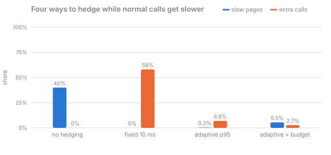

# Part 4 · Adaptive hedging

**Question:** how late is "late" when normal calls keep getting slower?

**Answer:** don't pick a number. Part 3's fixed 10 ms timer resent **86%** of calls once
normal calls drifted past 10 ms, and almost none of those copies helped. A timer set from
the last 1000 calls (their 95th percentile) moved with the drift: the same rescue of stuck
calls for **7%** extra calls. A budget can cap the extra calls hard, but it costs some slow
pages, and this part shows exactly which ones.

Read [Part 3](../part-3-tail-at-scale) first: this part picks up from
[its catch](../part-3-tail-at-scale#the-catch).

## Run it

```bash
uv run challenges/challenge-1-latency-under-load/part-4-adaptive-hedging/adaptive_hedging.py            # about two minutes
uv run challenges/challenge-1-latency-under-load/part-4-adaptive-hedging/adaptive_hedging.py --quick    # about a minute
```

## The idea, from zero

You're throwing a party and order food from 50 stalls at once. You can't eat until every
order has arrived. Now and then one stall forgets your order, and you wait forever.

- **Hedging** (part 3): if an order is late, place the same order again with another
  stall and take whichever arrives first.
- **A fixed timer**: "reorder anything not here after 10 minutes". On a quiet evening,
  orders take 3 minutes, so you only reorder the forgotten ones. On a busy Friday,
  every order takes 15 minutes, so you reorder almost everything: double the bill, and
  the food comes no sooner.
- **An adaptive timer**: "reorder only what is later than 95 of the last 100 orders".
  On Friday that means about 20 minutes, so you reorder only the truly stuck orders,
  whatever the evening is like.
- **A budget**: "at most 1 extra order for every 20 normal ones". Even if your timer
  goes wrong, the bill can't grow by more than 5%.

Three words this part adds:

- **Drift**: normal latency slowly changing over time, here from about 2 ms to about
  14 ms per call.
- **Rolling p95**: the 95th percentile of only the most recent calls. Old calls drop out,
  so it follows the drift. 95th percentile means 1 call in 20 took longer.
- **Budget**: a cap on extra calls, as a share of normal calls.

## What the part does

| Step | What happens | Code |
|---|---|---|
| 1 | Start a server with 128 workers, so no call (or copy) ever waits in line | [`WORKERS`](adaptive_hedging.py#L37), [`spawn`](adaptive_hedging.py#L229) |
| 2 | A page sends 50 backend calls at once and waits for all of them | [`K`](adaptive_hedging.py#L38), [`fan_out`](adaptive_hedging.py#L117), [calls sent](adaptive_hedging.py#L147-L151) |
| 3 | **The drift.** A normal call takes about 2 ms for the first quarter of the run, climbs steadily to about 14 ms through the middle half, and stays there for the last quarter. Each call is somewhere between half and 1.5 times that | [`QUIET, BUSY`](adaptive_hedging.py#L40), [`normal_time`](adaptive_hedging.py#L50), [`backend_work`](adaptive_hedging.py#L60) |
| 4 | 1 call in 100 gets **stuck** for 200 ms, whatever the drift | [`STUCK, STUCK_SHARE`](adaptive_hedging.py#L41), [stuck draw](adaptive_hedging.py#L61-L62) |
| 5 | Pages arrive at 10 per second. Every policy gets the same pages at the same times, with the same calls | [`FRONT_RATE`](adaptive_hedging.py#L39), [`measure`](adaptive_hedging.py#L198), [same seed](adaptive_hedging.py#L199-L200) |
| 6 | Try four policies: no hedging, fixed 10 ms, adaptive p95, adaptive p95 + 5% budget | [`POLICIES`](adaptive_hedging.py#L74-L79), [loop](adaptive_hedging.py#L233-L235) |
| 7 | Each call has its own timer from when it was sent. Every half millisecond, any call out longer than the timer gets a copy, and the first answer wins | [timer loop](adaptive_hedging.py#L159-L172), [late calls](adaptive_hedging.py#L162), [first wins](adaptive_hedging.py#L123-L137) |
| 8 | **Fixed timer**: always 10 ms | [`FIXED_DELAY`](adaptive_hedging.py#L43), [`delay`](adaptive_hedging.py#L90-L93) |
| 9 | **Adaptive timer**: time every call, keep the last 1000, hedge after their p95. Until 100 calls have been seen, use 10 ms | [timing each call](adaptive_hedging.py#L139-L144), [`PERCENTILE, WINDOW`](adaptive_hedging.py#L44), [warm-up](adaptive_hedging.py#L94-L95), [`RollingPercentile`](../../../toolkit/jiffy-metrics/src/jiffy_metrics/rolling.py#L23) |
| 10 | **Budget**: each page's 50 calls earn 50 × 5% = 2.5 hedges. A hedge spends 1, and is refused when there's less than 1 saved. At most 10 can be saved up | [`BUDGET, MAX_SAVED`](adaptive_hedging.py#L46), [earn](adaptive_hedging.py#L152), [ask](adaptive_hedging.py#L164), [`HedgeBudget`](../../../toolkit/jiffy-load/src/jiffy_load/budget.py#L35-L48) |
| 11 | A page counts as **slow** if it takes over 100 ms. A rescued stuck call lands well under that, an unrescued one well over | [`THRESHOLD`](adaptive_hedging.py#L42) |

## The results



One full run on this laptop, with other apps using about 60% of the CPU
([results.md](results.md)).

**A · Four ways to hedge**, same 50-call pages, normal calls drifting from 2 ms to 14 ms:

| policy | slow pages | p50 | p99 | extra calls | hedges that won | refused |
|---|---|---|---|---|---|---|
| no hedging | 40.0% | 27.1 ms | 215 ms | 0% | - | 0 |
| fixed 10 ms | 0.0% | 25.1 ms | 60.2 ms | **58.0%** | 2.4% | 0 |
| adaptive p95 | 0.34% | 25.3 ms | 72.0 ms | 6.9% | 15.7% | 0 |
| adaptive p95 + 5% budget | 5.5% | 24.8 ms | 213 ms | 2.7% | 35.3% | 524 |

**B · Phase by phase**: the timer each policy used, and the extra calls it sent:

| phase | normal call | fixed timer | adaptive timer | extra: fixed | extra: adaptive | extra: + budget |
|---|---|---|---|---|---|---|
| quiet | 2 ms | 10 ms | 18.0 ms | 21.8% | 6.3% | 2.1% |
| climbing | 2 → 14 ms | 10 ms | 22.9 ms | 62.1% | 7.9% | 2.8% |
| busy | 14 ms | 10 ms | 22.2 ms | **86.3%** | 5.6% | 3.2% |

**C · Where the budget said no** (adaptive p95 + 5% budget):

| hedges a page asked for | pages | asked | refused | slow pages |
|---|---|---|---|---|
| none | 131 | 0 | 0 | 0 |
| 1 to 9 | 131 | 289 | 29 | 5 |
| 10 to 50 | 28 | 632 | 495 | 11 |

### Where each number comes from

| Column | In plain words | Code |
|---|---|---|
| slow pages | share of pages that took over 100 ms | [`fraction_above`](adaptive_hedging.py#L249), [in the histogram](../../../toolkit/jiffy-metrics/src/jiffy_metrics/histogram.py#L101) |
| p50 / p99 | page wait: typical, and 1-in-100 worst | [`percentile`](adaptive_hedging.py#L250-L251), [in the histogram](../../../toolkit/jiffy-metrics/src/jiffy_metrics/histogram.py#L85) |
| extra calls | hedges sent, as a share of the 50 normal calls per page | [`extra`](adaptive_hedging.py#L192-L195), [used](adaptive_hedging.py#L252) |
| hedges that won | share of hedges that answered before the call they copied. The rest were wasted | [counted](adaptive_hedging.py#L129-L130), [share](adaptive_hedging.py#L253) |
| refused | hedges the budget said no to | [counted](adaptive_hedging.py#L168-L169), [total](adaptive_hedging.py#L254) |
| normal call (B) | the typical call time the drift asked for in that phase | [`normal_time`](adaptive_hedging.py#L273) |
| adaptive timer (B) | the middle value of the timer the adaptive policy used on that phase's pages | [timer per page](adaptive_hedging.py#L153), [median](adaptive_hedging.py#L269-L275) |
| extra per phase (B) | the same "extra calls", only for that phase's pages | [per phase](adaptive_hedging.py#L276-L278) |
| asked (C) | hedges sent plus hedges refused, grouped by how many one page wanted | [groups](adaptive_hedging.py#L299-L315), [asked](adaptive_hedging.py#L310) |

## What it means

- **The fixed timer backfires as the drift sets in.** In the quiet phase it resent 22%
  of calls, already too many because on this busy laptop even a 2 ms call often took
  more than 10 ms to come back. By the busy phase it resent 86%. Only 2.4% of its copies
  answered first: 97 out of every 100 were pointless.
- **The adaptive timer follows the calls.** It sat at 18 ms in the quiet phase and moved
  to about 22 ms once calls got slower, so it only fired for calls that really were
  late: 5–8% extra in every phase, the share a p95 timer should send.
- **Both rescued the stuck calls.** Slow pages went from 40% to 0.0% (fixed) and 0.34%,
  which is 1 page out of 290 (adaptive). The fixed timer's p99 is 12 ms better because
  it gives up on a call sooner. It paid for that with 8 times the extra calls.
- **The budget kept its promise, and it cost something.** Extra calls stayed under 5% in
  every phase (2.7% overall), but slow pages came back to 5.5%. Table C shows why:
  - 28 pages asked for 10 or more hedges at once. When most of a page is late together,
    the hold-up is on the caller's side (here, the busy laptop), not one stuck backend,
    and a copy won't help. The budget refused 495 of those 632 hedges, which is what a
    budget is for.
  - But 11 of those pages also had a truly stuck call, and its hedge was refused along
    with the others. 5 more slow pages hit an empty budget with only a few hedges to send.
- **A budget is a seat belt, not a free fix.** A p95 timer needs about 5% extra calls by
  design, so a 5% budget leaves no room for bad moments. Set it above what the timer
  normally needs, and use it to stop runaway hedging, not to tune it.

## The catch

- **Hedges are free on this bench and they aren't in real life.** The server's workers
  just sleep, and there are 128 of them, so the fixed timer's 58% extra calls cost
  nothing here except the count. On a real backend every extra call takes a share of
  its CPU or disk, so 58% more calls means 58% more load. [Part 3's busy
  run](../part-3-tail-at-scale#the-catch) showed what that does.
- **The adaptive timer measures what the caller sees**, not what the backend does. The
  18 ms in the quiet phase is mostly this laptop being busy, not the 2 ms of work.
  That's the point: it reacts to whatever makes calls late, so nobody has to know the
  right number in advance.
- **Measuring caught a mistake.** The first version timed every call from the start of
  its page instead of from when that call was sent. Sending 50 calls one after another
  takes a few milliseconds on a busy machine, and that got counted as latency. The
  adaptive timer then sat at 25–29 ms in *every* phase and didn't follow the drift at all.
  The fix: [each call gets its own timer](adaptive_hedging.py#L159-L172), measured on the
  [same clock](adaptive_hedging.py#L139-L144) the window uses.

## Try this

- [`BUDGET`](adaptive_hedging.py#L46) = 0.10: twice what a p95 timer should need. Do the
  slow pages come back down? What happens to extra calls?
- [`PERCENTILE`](adaptive_hedging.py#L44) = 99: a later timer, fewer hedges. Does it
  still rescue the stuck calls in time?
- [`WINDOW`](adaptive_hedging.py#L44) = 100 or 10000: a short memory reacts faster, a
  long one is steadier.
- [`BUSY`](adaptive_hedging.py#L40) = 0.030: a stronger drift. Watch the fixed timer's
  extra calls in the busy phase.

## Files

| File | What's in it |
|---|---|
| [adaptive_hedging.py](adaptive_hedging.py) | the whole part |
| [results.md](results.md) | the last full run |
| [test_adaptive_hedging.py](test_adaptive_hedging.py) | checks the drift, each policy's timer, that a hedge rescues a stuck call, and that an empty budget sends none |

The two reusable pieces live in the toolkit:
[`RollingPercentile`](../../../toolkit/jiffy-metrics/src/jiffy_metrics/rolling.py) and
[`HedgeBudget`](../../../toolkit/jiffy-load/src/jiffy_load/budget.py).
